# HOMEBOUND

A solar system repair mission — NASA Space Apps Challenge 2026

A stranded pilot must cross the solar system, recover seven ship parts from seven worlds, and fly home.
Every level is built on one real planetary fact, and that fact is the mechanic:

*   **Mercury** — 430 °C day / −180 °C night; the sun line sweeps the surface and heat waves rise from the regolith. Recover the **Solar Panel Array**.
*   **Venus** — 92 × Earth pressure and 465 °C heat under an acid-rain sky. Recover the **Hull Plating**.
*   **Mars** — 3.71 m/s² gravity (38% of Earth) makes every jump long and floaty; dust storms drop visibility to a circle around you. Recover the **Navigation Module**.
*   **Jupiter** — no ground, only storm platforms above the cloud decks in 2.5 g. Recover the **Shield Generator**.
*   **Saturn** — icy ring debris rains down between floating moonlets. Recover the **Fuel Cells**.
*   **Uranus** — 97° tilt: the sun creeps along the horizon through methane haze and sideways diamond rain. Recover the **Thermal Regulator**.
*   **Neptune** — 2,100 km/h supersonic winds that shove everything, including you. Recover the **Signal Antenna**.
*   **Earth** — drag all seven parts onto the ship in the assembly bay, recap the facts, land.

Missions unlock one after another: win Mercury to open Venus, win Venus to open Mars, and so on.

Laika, the ship's navigation core, guides the player with dialogue and hints. Every world has its own weather, parallax skyline, hazards, ground aliens, and patrol saucers. Cached NASA APOD data appears on the boot screen so the game runs fully offline.

The full playable arc — tutorial, seven planet worlds, Earth finale — is implemented, and the whole loop was verified end-to-end with a scripted headless playtest.

Target play time: about 25–30 minutes, with mid-level checkpoints so a judge can see the full arc in one sitting.

## Installation

**Prerequisites:** Python 3.12 (3.11 also works).

```bash
git clone https://github.com/imamsanghaarc/nasa.git
cd nasa
python -m venv .venv
source .venv/bin/activate        # Windows: .venv\Scripts\activate
pip install -r requirements.txt
python main.py
```

Never install plain `pygame`; use `pygame-ce`.

Optional — cache the NASA Astronomy Picture of the Day for the boot screen:

```bash
python tools/fetch_apod.py
```

See [PLAYGUIDE.md](PLAYGUIDE.md) for the full player guide.

## Documentation

- [README.md](README.md) — Main overview of the project
- [DOCS.md](DOCS.md) — Documentation index and reading order
- [DESIGN.md](DESIGN.md) — Game design document
- [TECHNICAL.md](TECHNICAL.md) — Technical reference
- [PLAYGUIDE.md](PLAYGUIDE.md) — Player guide
- [TOOLS.md](TOOLS.md) — Tools & testing
- [SCIENCE.md](SCIENCE.md) — NASA science appendix
- [DATA.md](DATA.md) — Data & content format reference
- [HACKATHON.md](HACKATHON.md) — Judges' submission notes
- [CONTRIBUTING.md](CONTRIBUTING.md) — Contributing guide

## What this project is

HOMEBOUND is an educational space game made for the NASA Space Apps Challenge 2026 hackathon.

The idea: space is hostile, and each planet's hostility becomes a playable rule. Instead of a quiz, the player *experiences* planetary science — low gravity on Mars, extreme temperature swings on Mercury, crushing pressure on Venus — while recovering the parts needed to repair their ship and return to Earth.

## Features

### Gameplay

*   Nine levels implemented: Earth orbit tutorial, seven full planet worlds (each with its own weather, hazards, and enemies), and the Earth assembly finale.
*   Each level teaches one verified NASA fact; facts are displayed on the solar map and recapped at the end.
*   Laika dialogue system with typewriter text, queued lines, idle hints, and death-based hints.
*   Part-collection loop with persistent save/load (progress survives a restart) and per-level best times.
*   Difficulty settings (Easy / Normal / Hard) that scale enemy and hazard speed, storm timing, hearts, and hint frequency.
*   Combat in every world: E fires the blaster, or stomp walkers from above; saucers shoot back.
*   Pause overlay (Resume / Restart / Mute / Quit to map) available in every scene.
*   Solar system map hub with sequential unlocks and a circular minimap, stopwatch, and labeled part target in every world — no time-limit losses, the stopwatch only records how long you took.
*   Mission briefing card before each world, and a stats screen at the end: total time, losses, parts recovered, facts learned, and best time per mission.

### Technical

*   Python 3.12 with pygame-ce (never plain `pygame`).
*   1280 × 720, 60 FPS, delta-time movement (identical behavior at 30 and 60 FPS).
*   Fully data-driven: all numbers, dialogue, and facts live in JSON under `data/`.
*   Procedural art drawn in code — the game runs with an empty `assets/` folder.
*   Synthesized sound effects generated at runtime — no audio files required, silent fallback if the mixer is unavailable.
*   Cached NASA APOD on the boot screen; the game never needs internet to run.
*   Async-friendly main loop so a pygbag web build remains possible (desktop is the demo target).
*   Graceful fallbacks everywhere: missing JSON, missing assets, missing audio, corrupt save — nothing crashes the game.

## Tech stack

| Layer | Choice | Why |
|---|---|---|
| Language | Python 3.12 | Pinned for `pygame-ce` wheel compatibility |
| Game library | pygame-ce >= 2.5.7 | Faster, maintained, better pygbag support than plain `pygame` |
| Rendering | Procedural `pygame.draw` primitives | Zero asset blocking; consistent retro look |
| Audio | Runtime synthesis | No audio files; silent fallback on any device |
| Data | JSON (`data/levels`, `data/planets`, `data/dialogue`) | Non-coders can retune numbers and dialogue |
| Save | JSON file next to the game (`savegame.json`) | Atomic write; corrupt saves never block startup |
| Window | 1280 × 720, 60 FPS, resizable with letterbox scaling | One target for all art and layouts |

## Project structure

```
HOMEBOUND/
├── main.py                     # Async main loop, window, scene bootstrap
├── requirements.txt            # pygame-ce
├── README.md
├── design.md
├── technical.md
├── playguide.md
├── .gitignore
│
├── core/                       # Engine
│   ├── settings.py             # Constants, paths, palette, scene names
│   ├── scene.py                # Scene base + SceneManager + Game
│   ├── game_state.py           # Single GameState: parts, facts, difficulty, save/load
│   ├── save.py                 # Atomic JSON save/load
│   ├── levels.py               # JSON loader + validation + playable-level helpers
│   ├── assets.py               # Font/image loading with graceful fallback
│   ├── audio.py                # Synthesized SFX, mute, no-crash if mixer missing
│   ├── text.py                 # Cached text wrapping + drawing
│   └── color.py                # Hex parsing + color math
│
├── scenes/                     # Screens
│   ├── boot.py                 # APOD splash screen
│   ├── menu.py                 # Title menu + settings
│   ├── map.py                  # Solar system hub, sequential unlocks, part icons
│   ├── tutorial.py             # Earth orbit tutorial
│   ├── world_level.py          # Shared 7-world engine (one scene class per planet)
│   └── ending.py               # Earth assembly finale + stats
│
├── entities/                   # Gameplay objects
│   ├── player.py               # Combat astronaut controller (move/jump/fire)
│   ├── pickups.py              # Parts, health, canisters, fragments, crates
│   └── enemies.py              # Walker aliens, patrol saucers, laser bolts
│
├── ui/                         # UI widgets
│   ├── hud.py                  # Hearts, 7-part inventory, target chip, stopwatch
│   ├── dialogue_box.py         # Laika's typewriter dialogue + hints
│   ├── meter.py                # Heat / pressure / fuel meters
│   ├── button.py               # Mouse + keyboard buttons
│   └── pause.py                # Pause overlay
│
├── art/                        # Procedural drawing helpers
│   ├── sprites.py              # Astronaut, Laika hologram, ship, alien, saucer, part icons
│   ├── planets.py              # Planet discs, bands, craters, rings, sun, orbits
│   ├── world_bg.py             # Per-planet parallax skylines (skies, bands, ridges)
│   └── backgrounds.py          # Starfields, nebulae, vignette, scanlines
│
├── data/                       # All gameplay content
│   ├── planets.json            # Map data, facts, part names, unlock chain
│   ├── levels/
│   │   ├── tutorial.json
│   │   ├── mercury.json … neptune.json   # one config per world
│   ├── dialogue/
│   │   ├── tutorial.json
│   │   ├── mercury.json … neptune.json   # Laika beats per world
│   └── cache/
│       └── apod.json           # Cached NASA APOD (offline fallback)
│
├── core/                       # (engine, see above)
│   ├── world_gen.py            # Seeded per-planet terrain/platform/pickup generation
│   └── weather.py              # Screen-space rain, dust, snow, lightning, meteors
│
├── assets/                     # Optional; game runs without any of these
│   └── fonts/
│       ├── PressStart2P-Regular.ttf
│       └── VT323-Regular.ttf
│
├── screenshots/                # Gameplay captures for the README
│
└── tools/                      # Dev / QA tools
    ├── fetch_apod.py           # Caches NASA APOD once; committed result keeps game offline
    ├── playtest.py             # Scripted end-to-end playtest of the full campaign
    ├── shot_world.py           # Headless screenshot capture of every world
    └── smoke_test.py           # Headless smoke test: boot every scene, run frames
```

## Levels and mechanics (real planetary facts)

| # | Level | Real mechanic | Part recovered | Est. time |
|---|---|---|---|---|
| 0 | Earth orbit (tutorial) | Movement, jump, fire, hint button | — (meet Laika) | 1 min |
| 1 | Mercury | 430 °C day / −180 °C night → sweeping sun line, heat waves, shadow hiding | Solar Panel Array | 4 min |
| 2 | Venus | 465 °C, 92 bar → acid rain, geysers, crushing haze | Hull Plating | 4 min |
| 3 | Mars | 3.71 m/s² gravity → floaty long jumps; dust storms drop visibility to a circle around you | Navigation Module | 4 min |
| 4 | Jupiter | 2.5 g storm gravity → floating cloud platforms, lightning towers | Shield Generator | 4 min |
| 5 | Saturn | Ring debris showers → falling ice hazards between moonlets | Fuel Cells | 4 min |
| 6 | Uranus | 97° axial tilt → low horizon sun, methane haze, sideways rain | Thermal Regulator | 4 min |
| 7 | Neptune | 2,100 km/h winds → constant sideways push, meteor showers | Signal Antenna | 4 min |
| 8 | Earth | Assembly + stats | Drag all 7 parts onto the ship; each snaps with its planet fact | — (finale) | 2 min |

Every world is generated from its `data/levels/*.json` config with a fixed seed, so terrain, platforms, checkpoints, hazards, walkers, and saucers are identical on every machine. Mid-level checkpoints keep deaths fair, and each mission ends at a labeled part pedestal, then an exit pad.

Total play time ≈ 25–30 minutes.

## Player flow

```
Boot (APOD splash, cached)
  → Menu (New mission / Continue / Settings / Quit)
    → Solar map (hub; shows the 7 parts, sequential unlocks)
        → Tutorial (auto on first run)
        → Mercury → Venus → Mars → Jupiter → Saturn → Uranus → Neptune (one at a time)
        → Earth finale (unlocked when all 7 parts are collected)
    → Stats screen → Menu (or New Game)
```

*   Missions unlock strictly in order: win a world and the next padlock opens on the map.
*   Any unlocked planet can be replayed for a better best time.
*   Pause overlay works in every scene (Esc): Resume / Restart / Mute / Quit to map.
*   Progress auto-saves on part pickup and on scene change; "Continue" loads it.

## Controls

| Action | Key |
|---|---|
| Move | WASD / arrow keys |
| Jump | Space (hold for higher) |
| Fire blaster | E |
| Pick up / interact | Walk into the item (proximity) |
| Laika hint | H |
| Advance dialogue | Space / Enter / click |
| Pause | Esc |
| Menu navigation | Up/Down + Enter, or mouse |

## How to run

```bash
git clone https://github.com/imamsanghaarc/nasa.git
cd nasa
python -m venv .venv
source .venv/bin/activate        # Windows: .venv\Scripts\activate
pip install -r requirements.txt
python main.py
```

Never install plain `pygame`; use `pygame-ce`.

The game opens at 1280 × 720 and runs fully offline — no internet or asset files required.

Optional boot-screen cache refresh:

```bash
python tools/fetch_apod.py
```

## Screenshots

### Boot & menu

| Boot | Menu |
|---|---|
| 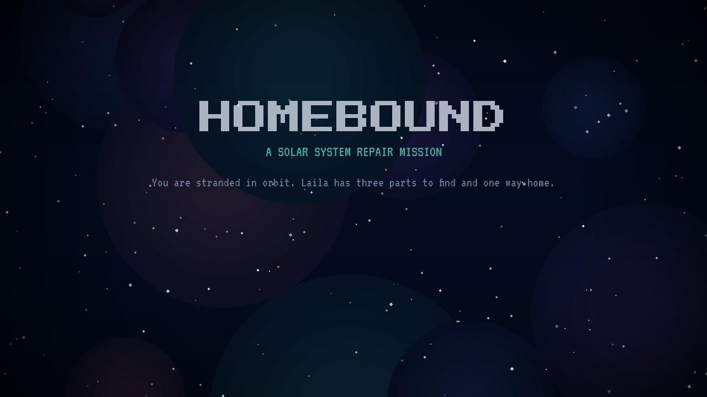 | 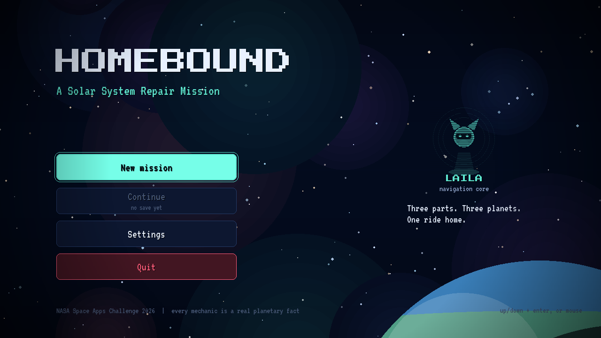 |

### Solar system

| Map | Tutorial | Mercury | Venus |
|---|---|---|---|
| 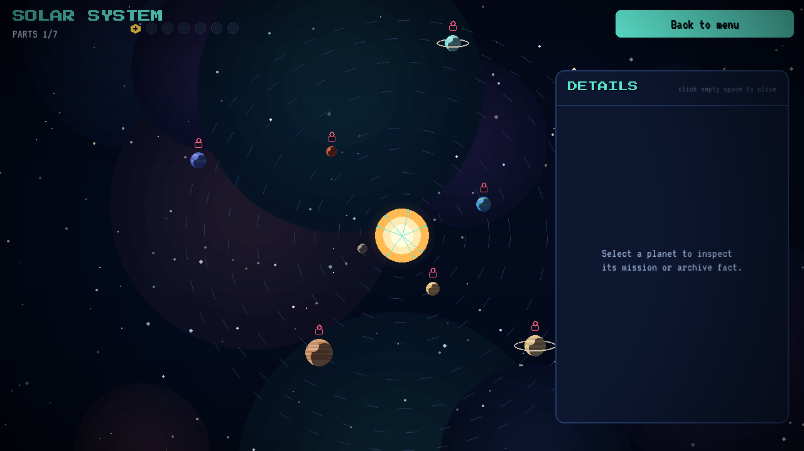 | 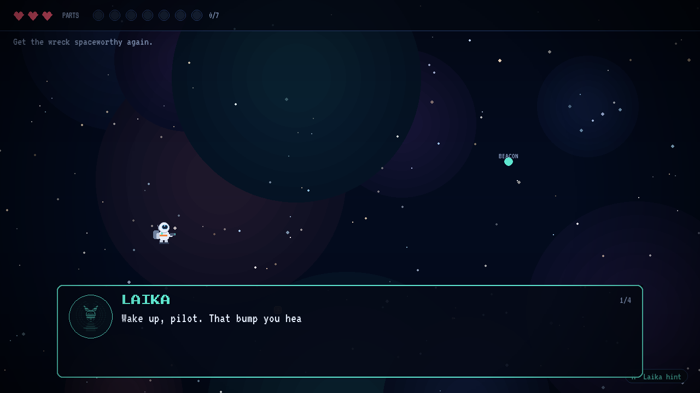 | 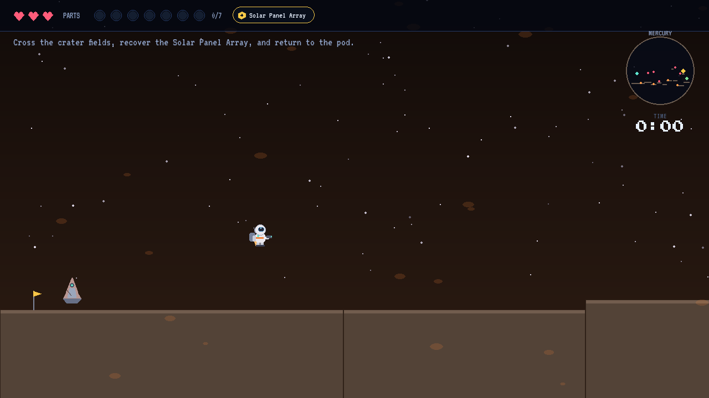 | 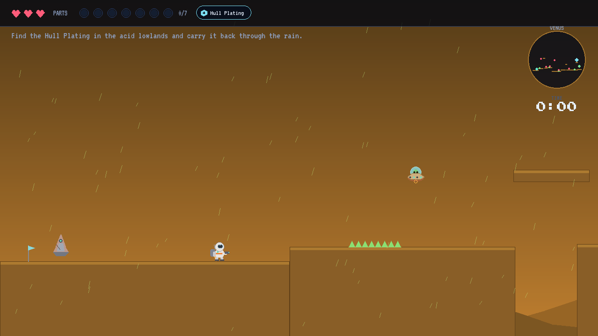 |

| Mars | Jupiter | Saturn | Uranus |
|---|---|---|---|
| 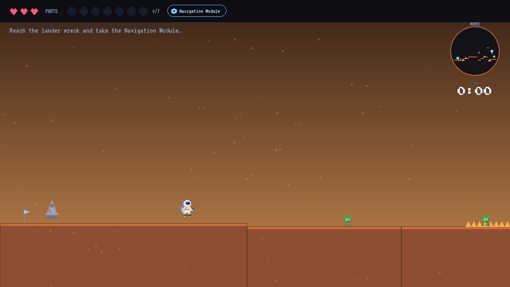 | 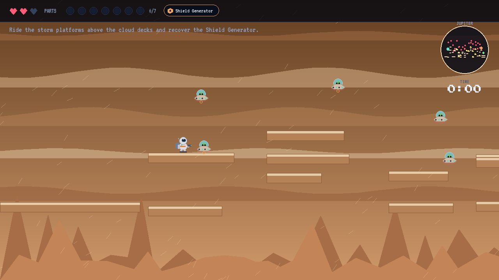 | 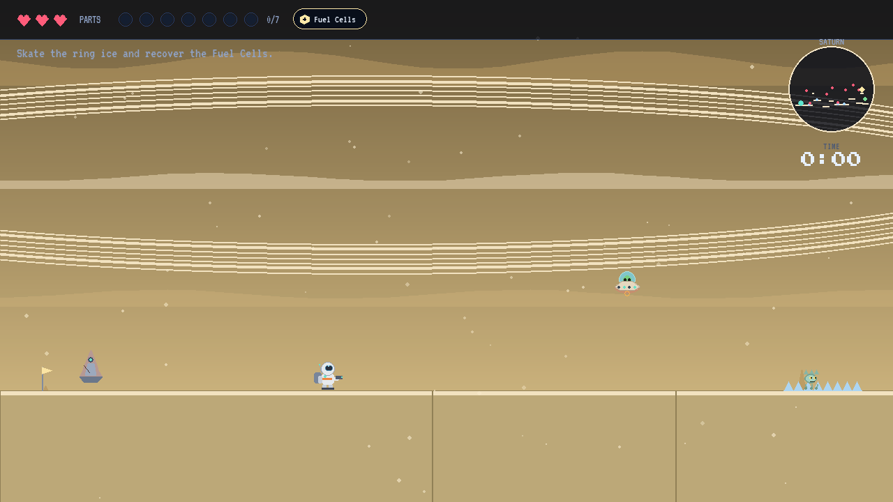 | 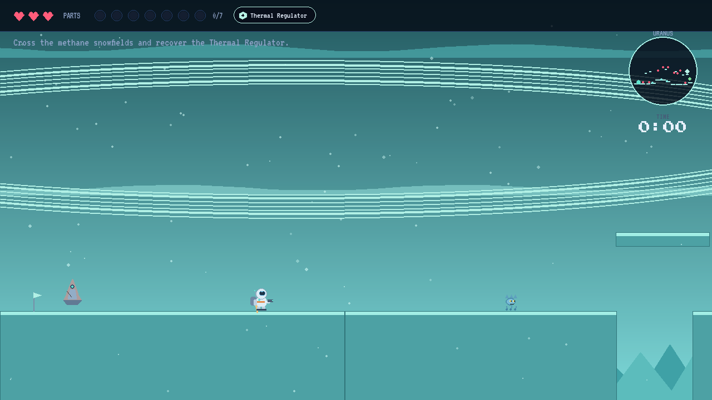 |

| Neptune | Mission brief | Dust storm | Assembly finale |
|---|---|---|---|
| 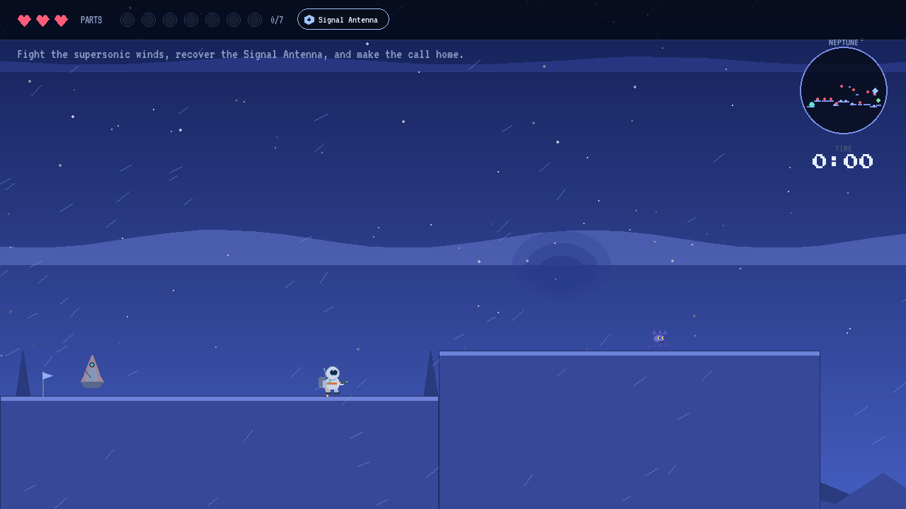 | 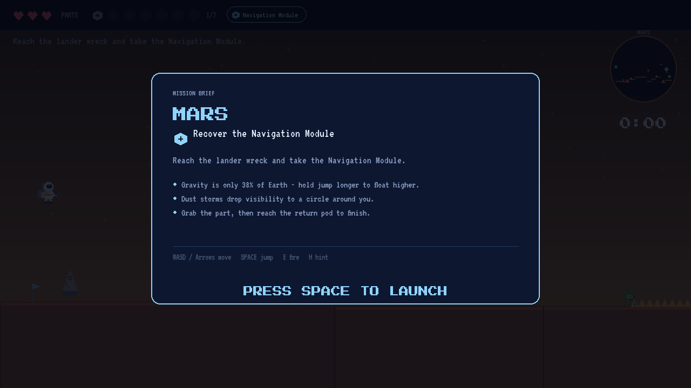 | 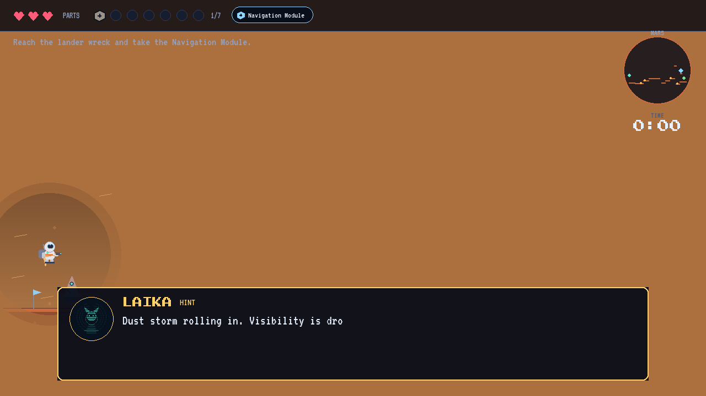 | 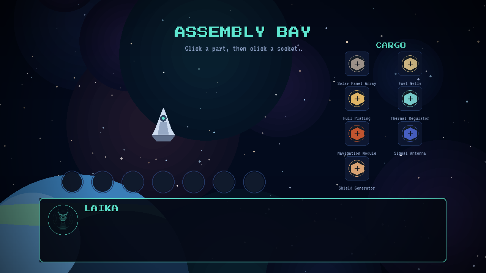 |

## Testing and tools

```bash
python tools/smoke_test.py   # headless smoke test: boot every scene, run frames, report
python tools/playtest.py     # scripted end-to-end playtest of the full game loop
python tools/fetch_apod.py  # one-time NASA APOD cache
```

See [TOOLS.md](TOOLS.md) for details.

## Team

*   **Sanghaar** — Lead, gameplay & content: levels, entities, data, art primitives, Laika's script.
*   **Sulaiman** — Engine & shell: scene manager, GameState, save, UI, audio, map, boot, menu, ending.
*   **Story and level design:** Victoria and team.

## NASA data & attribution

*   Planetary facts are drawn from NASA fact sheets (Mars, Mercury, Venus, Earth, Jupiter, Saturn, Uranus, Neptune) and verified before submission.
*   Boot screen uses NASA's Astronomy Picture of the Day (APOD), cached to `data/cache/apod.json` via `tools/fetch_apod.py`. If the fetch fails or there is no internet, a committed offline fallback keeps the game running.
*   All art and audio are procedural — generated in code, no external asset files required.

---

HOMEBOUND — every mechanic is a real planetary fact. Cached so it runs offline.
